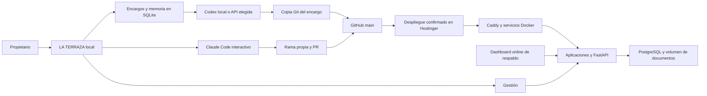

# Auditoría interna del ecosistema Educame

**Corte del 27 de noviembre de 2026.** La base de la revisión es `e6a4b780a3ad59a4588875ba6a4f8d9c113b13ab`. El inventario parte de los 1.233 archivos seguidos por Git en esa revisión. Las cifras siguientes identifican dónde se concentra el trabajo. Las cuentas, los encargos privados, los adjuntos personales y los borradores del propietario quedan fuera de este informe.

## Lectura para el propietario

Puedes asignar hoy un trabajo de Inglés a Claude Code y otro de Profesor Particular a Codex. Las copias de trabajo son independientes y comparten las reglas de producto. El mayor riesgo de trabajar a dos manos está en los HTML que combinan presentación, reglas y guardado, y en los cambios de API que alcanzan a más de una app. En esos casos conviene repartir por flujo completo o integrar primero el contrato compartido. [Primer acceso, reparto y entrega](trabajo-codex-claude.md)

En la consulta de producción, la revisión en ejecución y la última verificada coincidían en `e6a4b78`. El servidor respondió a salud, el trabajador y las copias emitían señales recientes y quedaba un 64,6 % del disco libre. Operación informó de correo saliente pendiente y cuatro llamadas de IA de Profesor Particular sin tarifa calculable. Estas observaciones corresponden al momento de la consulta. [Estado de la versión publicada](https://educame.tech/api/public/release)

## Arquitectura y autoridad sobre los datos

| Capa | Autoridad y puntos de entrada | Qué puede romper un cambio |
| --- | --- | --- |
| Web de los productos | Fuentes en `apps/`, landings en `marketing/app_landings_demo/`, rutas efectivas en `backend/app/api/app_routes.py`. El Dockerfile publica ciertos archivos en rutas distintas de sus rutas fuente. | Una vista puede abrir por archivo local y fallar en HTTP por una ruta de recurso incorrecta. Probar la entrada de la persona usuaria. |
| API y persistencia | FastAPI, SQLAlchemy y PostgreSQL. El inventario contiene 27 archivos de migración en `backend/alembic/versions/`. Los documentos tienen volumen propio. | Un cambio de esquema o identidad puede afectar a todas las cuentas. Probar datos anteriores, separación de cuentas y escrituras concurrentes. |
| Administración | El dashboard online y Gestión de LA TERRAZA llegan a la misma API. El puente local permite rutas y métodos concretos. Solo Apps y Contenido preparan modificaciones de producto. | El ocultamiento de un botón no sustituye permisos efectivos. Verificar una modificación desde ambas vistas y contemplar expiración de sesión y recuperación del borrador. |
| LA TERRAZA | Un proceso Node local, cola persistente, copias Git aisladas y recibos de publicación. La memoria portable recoge criterios confirmados. La sesión nativa de Claude tiene su propio historial. | Reintentar después de una caída podría duplicar una entrega o un coste. Revisar ID, revisión de base y recibo antes de repetir. |
| Publicación | GitHub es la referencia del código. Hostinger construye la imagen, copia datos, migra y verifica. El endpoint de versión distingue imagen activa y última revisión verificada. | Un commit en GitHub puede no estar en el VPS. Un error de despliegue debe conservar el recibo y el último estado verificado. |
| Servicios externos | El panel cuenta con adaptadores para Google Search Console, Buffer y Runway. Las apps tienen flujos de Google, recursos y proveedores de IA propios. | La presencia de un adaptador no acredita que la cuenta haya concedido acceso, que haya saldo ni que una publicación haya llegado al canal. |

## Dónde trabajar en cada producto

| Área | Recorrido que hay que conservar | Código que abrir primero | Evidencia a pedir en la entrega |
| --- | --- | --- | --- |
| Profesor Particular | Elegir curso/tema, preparar material, compartir por código y recuperar resultados por alumno. Distinguir el contexto del profesor del acceso del estudiante. | `apps/profesor/`, `backend/app/api/profesor_material_sessions.py`, servicios de generación y recuperación, landing y páginas SEO. | Sesión con alumno ficticio, corrección explicable, límites de plan, recarga y recuperación. El montaje de 61 juegos avanzados verifica que abren. Las soluciones y la didáctica requieren pruebas de partida. |
| ESO Adultos | Estudiar un tema, autocorregir, guardar avance, reanudar y ver el escritorio. Las misiones por asignatura y los recursos externos tienen recorridos distintos. | `apps/e25/index.html`, `apps/e25/assets/eso-*-missions.js`, módulos de recuperación y escenarios. | Una respuesta correcta y una incorrecta, premio único, recarga, navegación táctil y compatibilidad con progreso anterior. Para contenido nuevo, usar `docs/content-plan/`. |
| Inglés | Cambiar nivel, retomar la ruta de Juegos, abrir Temario/Biblioteca y practicar una destreza. La landing presenta estos usos. | `apps/cambridge/index.html`, `apps/cambridge/assets/studio/`, `apps/cambridge/assets/listening/`, `marketing/app_landings_demo/cambridge.html`. | Distinguir B2/C1/C2, reproducción de audios reales de prueba, borradores y ausencia de doble avance. Una prueba de reproducción no demuestra que un micrófono real o una transcripción de pago estén autorizados. |
| Diplomator | Entrar en una sesión de idioma, trabajar temas y conservar la práctica oral y las exportaciones. | `apps/diplomator/index.html`, `backend/app/services/diplomator_pdf.py`. | Cambiar de idioma y sesión, reabrir el historial y generar un PDF con datos ficticios. |
| Universidad +25 | Entrada de acceso a mayores de 25, recursos y progreso propios. En el corte consultado figuraba pausada. | `apps/u25/index.html`, landing `universidad-25.html`, acceso de producto en FastAPI. | Comprobar el comportamiento de pausa y usar una cuenta de ensayo local para estudiar. Preservar esa pausa al implementar o desplegar otra app. |
| Facturas OCR | Subir documento, procesar en segundo plano, revisar contra el original y exportar. Figuraba pausada. | `apps/ocr/index.html`, `backend/app/api/ocr.py`, `backend/app/services/ocr_worker.py` y `backend/app/ocr_engine/`. | Factura ficticia, separación por organización y rol, revisión de campos y recuperación tras fallo del trabajador. Un OCR correcto en una muestra no garantiza exactitud contable general. |
| GADEOS / Juegos del Hambre | Acceso privado, planning completo, Recorrido y Restaurantes con sus claves. Dos pruebas en autobús, seis en el pueblo y dos en el refugio. Batalla tras diez. | `apps/gadeos/`, `backend/app/services/gadeos.py`, `backend/app/api/chinchon.py`, editor privado de LA TERRAZA. | Dos cuentas ficticias, desbloqueos comprobados en servidor, revelación persistente de la ventana tras la prueba 9, sobres y marcador sin duplicados. Conservar identidad pública y material privado. |
| HazloTú | Acceso web con sus reglas de disponibilidad y protección. Revisar la ruta para entender la implementación existente. | `marketing/app_landings_demo/hazlatu.html` y rutas de `/hazlo-tu` en `app_routes.py`. | Estado de disponibilidad, acceso con/sin permiso y enlace correcto. En la base auditada su página reside en marketing. |
| Apps privadas nuevas | Catálogo, disponibilidad, acceso por nombre y contraseña, y área editable por producto. | `apps/private-workspace/`, `apps/custom/`, `backend/app/api/private_apps.py`, `app-catalog.mjs`. | Crear app y usuario ficticios, cambiar acceso, conservar datos y ver el resultado desde la otra administración. |
| LA TERRAZA, landings y dashboard | Cola única, Memoria, Contenido, Gestión, Operación, publicación y estadísticas. Diferenciar editar el código, operar la base y publicar contenido externo. | `scripts/educame-dashboard.mjs` y sus módulos, `admin/`, `marketing/app_landings_demo/`. | Cola tras reinicio, publicación y deshacer en remoto de ensayo, destino de operaciones, permisos, teclado y móvil. Comprobar claims de marketing contra la versión que se mostrará. |

**Tamaño del cambio potencial.** Profesor Particular contiene 375 archivos versionados en su carpeta de app, frente a 58 en ESO, 74 en Inglés, 14 en Diplomator y 10 en Universidad. Los HTML principales de ESO e Inglés ya alcanzan 8.312 y 6.347 líneas respectivamente. Facturas concentra su interfaz en un solo HTML. Las bibliotecas y recursos compartidos también viven en el backend. Una manera de disminuir conflictos es extraer un módulo cuando se modifique el flujo que contiene, con una prueba de comportamiento antes de moverlo. Evita encargar dos reorganizaciones generales simultáneas.

## Hallazgos y decisiones

| Prioridad | Hallazgo | Resolución o siguiente comprobación |
| --- | --- | --- |
| Alta | Las versiones fijadas de Pillow 12.3.0 y pypdf 6.21.1 tenían avisos publicados. Ambos formatos entran en flujos de usuario. | Fijadas Pillow 13.0.0 y pypdf 6.21.4. Verificar PDF, imágenes y OCR en datos ficticios y la construcción Linux antes de desplegar. El informe de PyPI es por versión y las identificaciones de distintas bases pueden solaparse. |
| Alta | Faltaba correo de cuentas en producción. | Configurar SMTP en el entorno operativo cuando el propietario disponga de remitente y credenciales. Hacer un alta y una recuperación con un buzón de prueba antes de anunciar esos flujos. |
| Alta para costes | Cuatro llamadas del periodo no tenían tarifa. | En Gestión, contrastar proveedor y modelo con su factura, introducir las tarifas aplicables y revisar el agregado. Mantener visible el contador de llamadas sin precio. |
| Trabajo paralelo | La cola tenía cliente Anthropic pero faltaba una entrada para una persona que compra Claude Code. Los dos programas podían coincidir en el checkout principal. | Acceso desde Conexiones al cliente oficial con copia Git independiente. El motor por API sigue usando la cola. El propietario mantiene el control de su inicio de sesión. |
| Contexto | GADEOS aún indicaba al agente que el sábado estaba cerrado y los retos eran lineales. La ficha de LA TERRAZA enviaba al propietario al dashboard para gestiones ya integradas. | Corregidas ambas fichas y la frase contradictoria de Restaurantes en la guía. Se verificó la lógica de requisitos en el servidor. Los datos editados por el propietario siguen siendo la fuente del planning. |
| Contexto | Al implementar por API, ciertos documentos de raíz y guías compartidas quedaban fuera de los archivos que podía consultar el agente. | Acceso de lectura explícito a las instrucciones y al informe. Se conserva el ámbito original de escritura de cada encargo. Hay una regresión para lectura, reemplazo y escritura. |
| Pruebas de Inglés | La prueba de Listening buscaba un reproductor que había desaparecido únicamente de la landing. Eso hacía fallar ambos navegadores después de probar los audios. | El ensayo sigue reproduciendo y pausando siete archivos. En la landing abre el ejemplo de transcripción y cambia a Writing, acorde con el diseño explicativo actual. |
| Calidad continua | CI tiene una lista explícita de suites de navegador, además de unitarias, backend y análisis de dependencias. Existen guiones de producto adicionales que no forman parte de esa lista. | Para cada entrega anotar la prueba específica que aporta cobertura al flujo. En los juegos, separar «abre todos los tableros» de «resuelve, explica el error y guarda». |
| Alta para integrar | GitHub canceló el trabajo de navegador de la base auditada al agotar 20 minutos. El trabajo de backend llegó a fallar en la auditoría de dependencias. | Unitarias, navegador de estudio y navegador de gestión pasan a tres trabajos paralelos. Se mantiene el resultado agregado `browser` y el análisis de Python en `checks`. [Ejecución anterior](https://github.com/julianjm9-cell/GadeaProject/actions/runs/45390333657) |
| Operación local | SQLite y los adjuntos del panel viven en el equipo. Una copia del VPS cubre otros datos. | Ensayar la recuperación de LA TERRAZA con una copia privada y separada antes de trasladarla a otro PC. La exportación de Memoria es suficiente para instrucciones, no para restaurar encargos ni conexiones. |

Las versiones de los paquetes y sus avisos pueden consultarse en los registros oficiales. [Pillow 12.3.0](https://pypi.org/pypi/Pillow/12.3.0/json) · [Pillow 13.0.0](https://pypi.org/pypi/Pillow/13.0.0/json) · [pypdf 6.21.1](https://pypi.org/pypi/pypdf/6.21.1/json) · [pypdf 6.21.4](https://pypi.org/pypi/pypdf/6.21.4/json)

## Primeros encargos independientes

1. **Claude, Inglés.** Revisar dónde se pierde el hilo al volver a Juegos. Entregar una mejora visible y una prueba que empiece con progreso ya guardado. Archivos previstos en `apps/cambridge/assets/studio/`.
2. **Codex, Profesor Particular.** Elegir un juego avanzado concreto y revisar tres respuestas plausibles, la explicación de error y el resultado final en móvil. Dejar el caso didáctico en su prueba específica.
3. **Siguiente integración compartida.** Priorizar la recuperación de cuentas por correo o las tarifas de IA cuando el propietario aporte la configuración. Antes de cambiar el esquema, acordar responsable, consumidor de la API y evidencia de compatibilidad con datos anteriores.

## Cómo repetir las comprobaciones

| Área | Entrada reproducible | Alcance |
| --- | --- | --- |
| Núcleo local | `npm.cmd test` | Unitarias de productos, cola, herramientas, publicación, restauración y administración. |
| Navegadores | `npm.cmd run test:browser` | Selección mantenida de Chromium y WebKit, cuentas y servicios de prueba. |
| Profesor Particular | `node tests/profesor-all-advanced-browser.cjs` | Montaje del catálogo avanzado. Ejecutar además una partida del tipo modificado. |
| Diplomator | `node tests/diplomator-bilingual-browser.cjs` | Sesión bilingüe, práctica oral, temas y móvil con datos de ensayo. |
| Backend | Desde `backend/`, con `PYTHONPATH=.`, `ENVIRONMENT=test` y `DATABASE_URL=sqlite://`, ejecutar `python -m pytest tests -q -p no:cacheprovider`. | Cuentas, progreso, licencias, generación, documentos, moderación y migraciones. El caso de bloqueos reales requiere `AUDIT_POSTGRES_URL` de un PostgreSQL desechable. |
| Contratos de motor | `node --test tests/educame-providers.test.cjs tests/educame-chat-images.test.cjs` | Mensajes, herramientas, imágenes, revisión, reanudación y remoto Git de ensayo. Se simulan las respuestas del proveedor. |
| Producción | Salud, versión pública y lectura de `python -m app.operation_check` dentro del backend del VPS | Qué está desplegado y salud operativa. Una cuenta real, servicios de pago y redes sociales requieren una verificación distinta. |

La referencia para CI es [el workflow versionado](../.github/workflows/quality.yml). Para desplegar, seguir [el procedimiento de Hostinger](../infra/HOSTINGER_UPDATE.md). Para revisar contenidos sin abrir código, usar [Contenido](terraza-contenido.md). Para cuentas, licencias y avisos, usar [Gestión](terraza-gestion.md).
